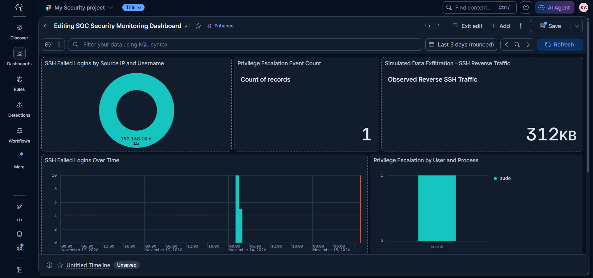
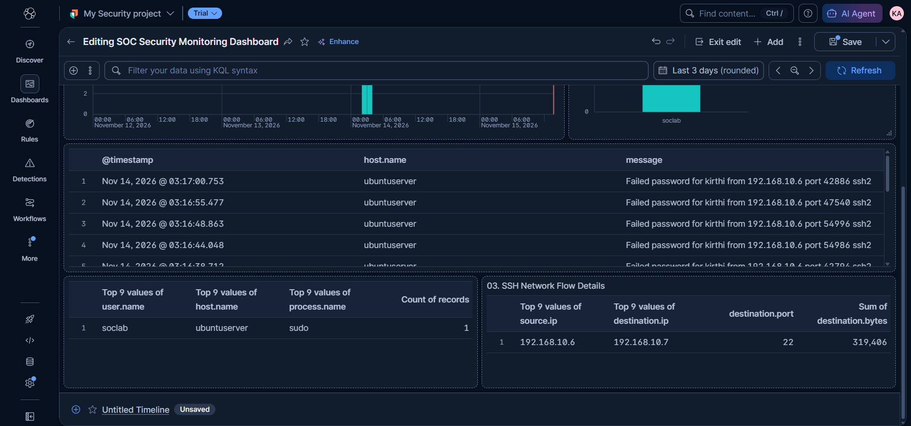

# Project 7 – SOC Security Monitoring Dashboard

## Project Overview

This project demonstrates practical Security Operations Center (SOC) monitoring and investigation using Elastic Security and Kibana.

I implemented three security scenarios in a controlled lab environment to understand how different security activities can be generated, monitored, and investigated through a SIEM platform.

The three scenarios covered in this project are SSH Brute-Force Detection, Privilege Escalation Detection, and Simulated Data Exfiltration Through SSH.

For each scenario, I performed controlled lab activities, collected relevant security events or network information, and investigated the results using Elastic Security.

The main outcome of this project is a centralized **SOC Security Monitoring Dashboard**, developed in Kibana by combining the important visualizations from all three scenarios.

The dashboard provides a consolidated view of authentication failures, privilege escalation activity, and SSH network traffic in one place.

## Project Objectives

- Perform practical security simulations in a controlled lab environment.
- Collect and investigate authentication and system activity logs.
- Identify repeated failed SSH login attempts.
- Investigate privilege-related command execution.
- Examine SSH network communication associated with file transfers.
- Use Elastic Security to search and investigate security events.
- Create Kibana visualizations for different security activities.
- Develop a centralized SOC monitoring dashboard.

## Lab Environment

### Virtual Machines

**Kali Linux**

Used as the testing and attacker machine for SSH brute-force simulation and controlled SSH file-transfer activities.

**Ubuntu Server**

Used as the target system for authentication monitoring, privilege escalation simulation, and SSH file-transfer activity.

### Security Monitoring and Investigation Tools

**Elastic Security (ELK Stack)**

Used for collecting, searching, and investigating security-related events.

**Kibana Discover**

Used to examine the ingested authentication, system, and network events.

**Kibana Dashboards**

Used to create visualizations and combine the monitoring panels into a centralized SOC dashboard.

### Other Tools and Technologies

- Hydra
- SSH
- SCP
- Linux Authentication Logs
- Sudoers Configuration
- SHA-256 Hashing

## Security Scenarios Implemented

### Scenario 1 – SSH Brute-Force Detection

In this scenario, I simulated repeated SSH login attempts from Kali Linux against an Ubuntu Server using Hydra.

The objective was to generate failed authentication events and investigate the activity using Elastic Security.

I verified the failed login records in the Ubuntu authentication logs and examined the collected events in Kibana Discover.

I focused on identifying repeated authentication failures, timestamps, source IP addresses, and the targeted username.

The investigation covered:

- SSH brute-force simulation using Hydra.
- Verification of failed authentication records.
- Authentication event investigation in Elastic Security.
- Identification of the source IP address.
- Identification of the targeted username.
- Monitoring failed login activity over time.
- Creation of SSH authentication monitoring visualizations.

This scenario demonstrated how repeated failed login attempts can be investigated and monitored through a SIEM platform.

### Scenario 2 – Privilege Escalation Detection

In this scenario, I performed a controlled privilege escalation simulation on the Ubuntu Server.

I configured a sudoers permission for a test user named `soclab`, allowing the user to execute the `/usr/bin/find` command with root privileges without entering a password.

After verifying the configuration, I demonstrated the resulting root-level shell and examined the related command execution activity.

I then investigated the available event information in Elastic Security and created visualizations to monitor the privilege-related activity.

The investigation covered:

- Sudoers permission configuration.
- Controlled privilege escalation simulation.
- Verification of elevated privileges.
- Investigation of command execution activity.
- Identification of the associated user and process.
- Creation of privilege escalation monitoring visualizations.

This scenario demonstrated how privilege-related activity can be examined through system event information and presented in a SIEM dashboard.

### Scenario 3 – Simulated Data Exfiltration Through SSH

In this scenario, I performed a controlled file-transfer exercise between the Ubuntu Server and Kali Linux using SSH and SCP.

I used harmless test data for the simulation. Before transferring the file, I verified the test file and calculated its SHA-256 hash.

I then transferred the file from the Ubuntu Server to Kali Linux using SCP.

After completing the transfer, I investigated the associated SSH network communication in Elastic Security.

The investigation covered:

- SSH connectivity between the lab systems.
- Test file verification.
- SHA-256 hash calculation.
- Controlled SCP file transfer.
- Network-flow investigation in Elastic.
- Identification of source and destination IP addresses.
- Investigation of SSH destination port and network traffic information.

The observed network communication included:

- Source IP: `192.168.10.6`
- Destination IP: `192.168.10.7`
- Protocol: `TCP`
- Destination Port: `22`

This scenario demonstrated how network-flow information can support the investigation of file-transfer activity.

The exercise was performed using harmless test data in a controlled lab environment. It was a simulated file-transfer activity, not a confirmed malicious data-exfiltration incident.

## SOC Security Monitoring Dashboard

The main objective of this project was to combine the monitoring results from all three scenarios into a centralized SOC dashboard.

After completing the individual investigations, I created a Kibana dashboard named:

**SOC Security Monitoring Dashboard**

The dashboard brings together the relevant visualizations from the three scenarios and provides a consolidated view of the security activities generated during the lab.

### Dashboard Monitoring Sections

**1. SSH Brute-Force Monitoring**

- SSH Failed Logins by Source IP and Username.
- SSH Failed Logins Over Time.
- SSH Failed-Login Event Details.

**2. Privilege Escalation Monitoring**

- Privilege Escalation Event Count.
- Privilege Escalation by User and Process.

**3. Data Exfiltration and Network Monitoring**

- Simulated Data Exfiltration – SSH Reverse Traffic.
- SSH Network Flow Details.
- Source IP Address.
- Destination IP Address.
- Destination Port.
- Destination Bytes.

### Dashboard Overview

The following screenshot shows the completed SOC Security Monitoring Dashboard, combining the visualizations from all three security scenarios.

### Dashboard Investigation Evidence

The following screenshot shows the detailed investigation information available in the dashboard, including authentication events, privilege-related activity, and SSH network-flow details.

## Overall Dashboard Results

During the captured dashboard session, the following metrics were displayed:

- SSH failed-login visualization: 15 events.
- Privilege escalation event count: 1.
- Observed reverse SSH traffic: 312 KB.

The detailed SSH network-flow view displayed the following information:

- Source IP: `192.168.10.6`
- Destination IP: `192.168.10.7`
- Destination Port: `22`
- Destination Bytes: `319,406`

These values represent the information displayed in the captured dashboard and investigation views.

The dashboard made it possible to review the monitoring results from the three scenarios through a single interface.

## Skills Demonstrated

Through this project, I gained practical experience in:

- SSH Brute-Force Simulation and Investigation.
- Linux Authentication Log Analysis.
- Privilege Escalation Investigation.
- Sudoers Configuration Review.
- SSH and SCP File-Transfer Investigation.
- SHA-256 Hash Verification.
- Elastic Security.
- Kibana Discover.
- Kibana Visualizations.
- SOC Dashboard Development.
- Security Event Monitoring.
- SIEM-Based Investigation.

## Conclusion

Through this project, I implemented three practical security scenarios and developed a centralized SOC Security Monitoring Dashboard using Elastic Security and Kibana.

I investigated SSH authentication failures, performed a controlled privilege escalation simulation, and examined SSH network activity associated with a test file transfer.

The final dashboard combined the relevant visualizations from all three scenarios and provided a centralized view of the security activities generated during the lab.

This project strengthened my practical understanding of SIEM-based security monitoring, event investigation, network-flow analysis, and dashboard development.

All activities were performed in a controlled lab environment for educational and defensive security learning purposes.

**Project Focus:** SOC Monitoring, Security Investigation, and Visualization
