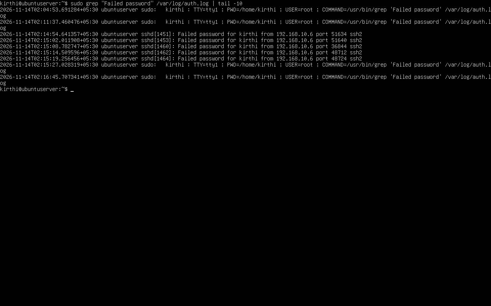
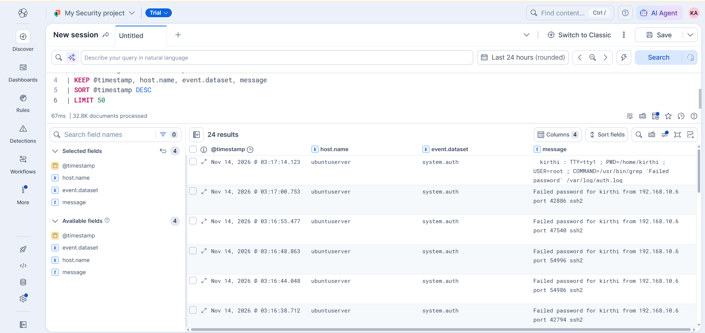
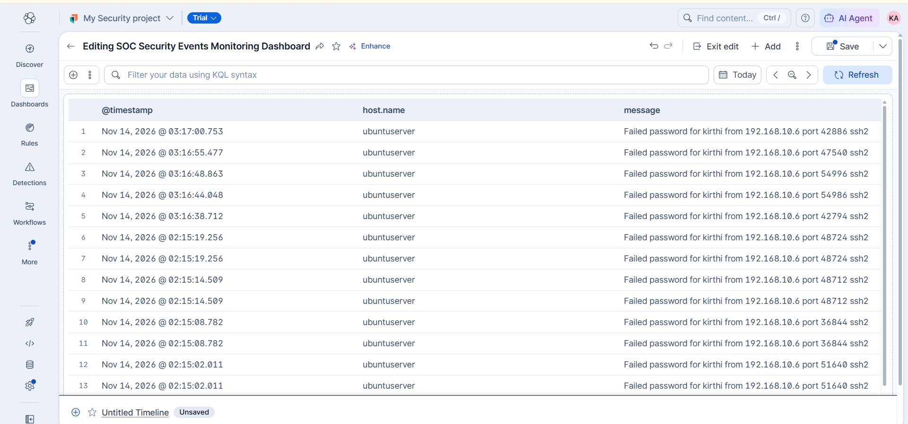
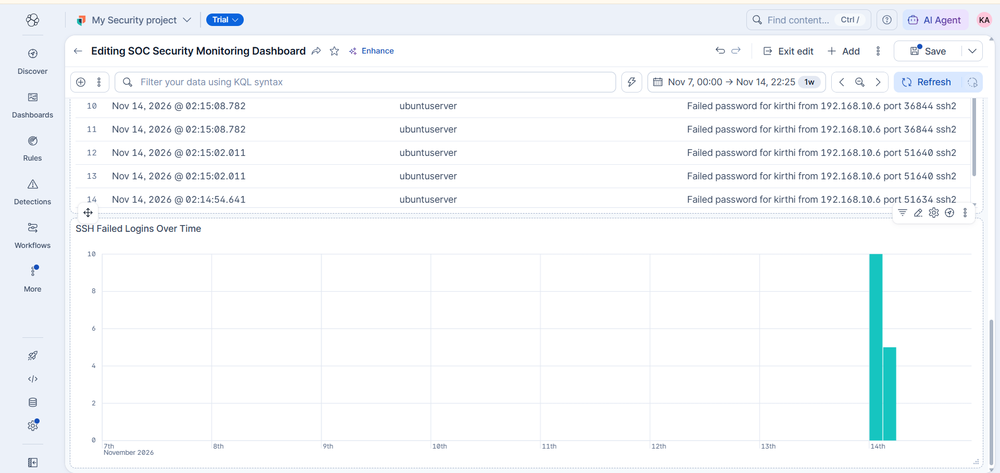
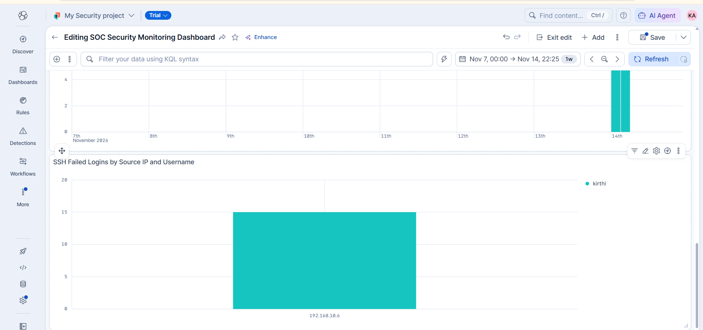

# Scenario 1 – SSH Brute-Force Detection and Monitoring

## 1. Introduction

In this scenario, I performed a controlled SSH brute-force simulation using Kali Linux against an Ubuntu Server. The purpose was to generate repeated failed SSH authentication events and investigate how these activities could be monitored using Elastic Security.

After generating the login attempts, I verified the authentication records on the Ubuntu Server and checked whether the corresponding events were collected in Elastic. I then created Kibana visualizations to monitor failed SSH login activity, identify the source IP address, and determine the targeted username.

This scenario demonstrates the process of generating security events, verifying log collection, investigating authentication activity, and presenting the findings through a SIEM dashboard.

## 2. Objectives

The main objectives of this scenario were:

- Simulate repeated SSH login attempts in a controlled lab environment.
- Generate failed SSH authentication events on the Ubuntu Server.
- Verify the authentication records using Linux system logs.
- Investigate the collected authentication events in Elastic Discover.
- Identify the source IP address and targeted username.
- Create Kibana visualizations to monitor failed SSH login activity.
- Present the investigation results through a centralized dashboard.

## 3. Lab Environment

### Attacker Machine
Kali Linux

### Target Machine
Ubuntu Server

### SIEM Platform
Elastic Cloud (ELK Stack)

### Log Investigation
Kibana Discover

### Dashboard and Visualization
Kibana Dashboards

### Log Source
Ubuntu authentication log: `/var/log/auth.log`

### Elastic Dataset
`system.auth`

### Lab Network Details

- Attacker Source IP: `192.168.10.6`
- Target System: Ubuntu Server
- Targeted Username: `kirthi`
- Authentication Service: SSH
- Protocol: SSH

## 4. SSH Brute-Force Simulation

I used Kali Linux to generate repeated SSH login attempts against the Ubuntu Server.

The simulation was performed in a controlled lab environment to generate failed authentication events for investigation.

The attempts originated from the Kali Linux machine with the source IP address `192.168.10.6` and targeted the username `kirthi`.

### Evidence 1 – SSH Brute-Force Simulation

## 5. Authentication Log Verification on Ubuntu

After performing the SSH login attempts, I verified whether the Ubuntu Server recorded the failed authentication activity.

I used the following command to review the failed SSH password entries:

`sudo grep "Failed password" /var/log/auth.log | tail -10`

The output displayed multiple failed SSH password attempts associated with the username `kirthi`.

The records also showed the source IP address `192.168.10.6`.

This confirmed that the simulated SSH login activity generated failed authentication records on the Ubuntu Server.

### Evidence 2 – SSH Failed Login Logs in Elasticsearch

## 6. Authentication Event Investigation in Elastic

After verifying the authentication records on Ubuntu, I checked whether the events were successfully collected in Elastic.

I used Kibana Discover to investigate the ingested authentication events under the `system.auth` dataset.

During the investigation, I reviewed:

- Event messages.
- Event timestamps.
- Host information.
- Failed password records.
- Authentication activity associated with the SSH service.

The collected records contained failed password messages associated with the simulated login attempts.

The target host was identified as `ubuntuserver`.

This step helped verify that the authentication events generated during the simulation were available in Elastic for further investigation.

## 7. Kibana Dashboard Visualizations

After verifying the collected authentication events, I created dashboard visualizations in Kibana to make the SSH login activity easier to monitor.

I created three visualizations for this scenario.

### 7.1 SSH Failed Login Event Table

I created a table visualization to display the collected failed SSH login records.

The table helped me review individual authentication events, including their timestamps, host information, and event messages.

This provided a detailed view of the failed login activity recorded during the simulation.

### Evidence 3 – SOC Dashboard SSH Failed Logins

### 7.2 SSH Failed Logins Over Time

I created a time-series visualization named **SSH Failed Logins Over Time**.

This visualization displays the distribution of failed SSH login events across the selected time range.

It helps identify periods in which repeated authentication failures were recorded and provides a timeline-based view of the authentication activity.

### Evidence 4 – SSH Failed Logins Over Time

### 7.3 SSH Failed Logins by Source IP and Username

I also created a visualization named **SSH Failed Logins by Source IP and Username**.

The purpose of this visualization was to identify the source address from which the failed login attempts originated and the username targeted during the simulation.

The captured results showed:

- Source IP Address: `192.168.10.6`
- Targeted Username: `kirthi`
- Failed Login Events: `15`

This visualization helped identify the source system and the targeted account associated with the repeated authentication failures.

### Evidence 5 – SSH Failed Logins by IP and Username

## 8. Investigation Findings

The investigation confirmed that the controlled SSH login simulation generated multiple failed authentication records on the Ubuntu Server.

The corresponding authentication events were available in Elastic under the `system.auth` dataset.

The captured dashboard results showed:

- 15 failed SSH login events.
- Source IP address: `192.168.10.6`.
- Targeted username: `kirthi`.
- Target system: Ubuntu Server.

The dashboard visualizations provided different views of the same authentication activity.

The event table supported individual event review, the time-series chart displayed the distribution of failures over time, and the source IP and username visualization helped identify the origin and targeted account.

These results demonstrate how authentication logs can be used to investigate repeated SSH login failures in a SOC environment.

## 9. Security Relevance

Repeated failed SSH authentication attempts can be an indication of password-guessing or brute-force activity.

From a SOC analyst's perspective, monitoring these events can help identify:

- Repeated authentication failures.
- Suspicious source IP addresses.
- Accounts targeted by repeated login attempts.
- Unusual increases in failed authentication activity.
- Potential unauthorized access attempts requiring further investigation.

In this lab, the activity was simulated intentionally. The observed failed login records were used to understand how such activity can be investigated through SIEM tools.

## 10. Conclusion

In this scenario, I successfully performed a controlled SSH brute-force simulation using Kali Linux against an Ubuntu Server.

I verified the generated failed authentication records using the Ubuntu authentication log and investigated the collected events in Elastic Discover.

I then created Kibana visualizations to display failed SSH login records, monitor authentication activity over time, and identify the source IP address and targeted username.

This exercise provided practical experience in Linux authentication log analysis, SIEM event investigation, source IP identification, and security dashboard development.

It also helped me understand how a SOC analyst can use authentication logs and SIEM visualizations to monitor and investigate suspicious SSH login activity.
