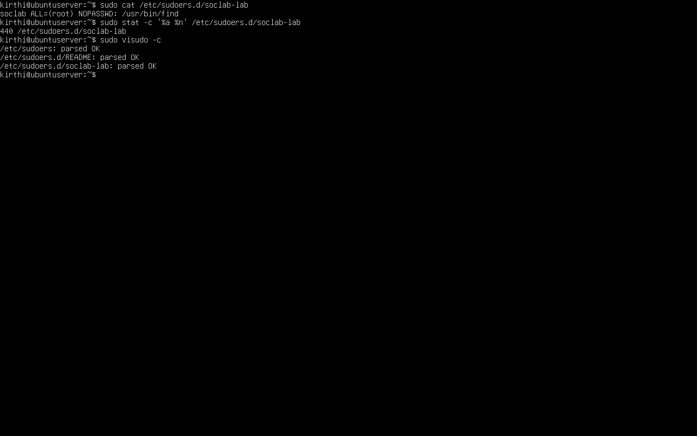
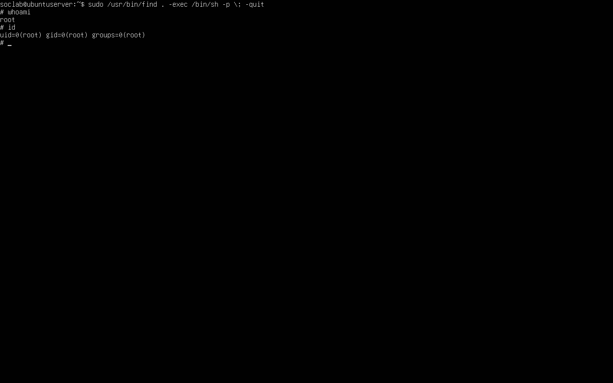
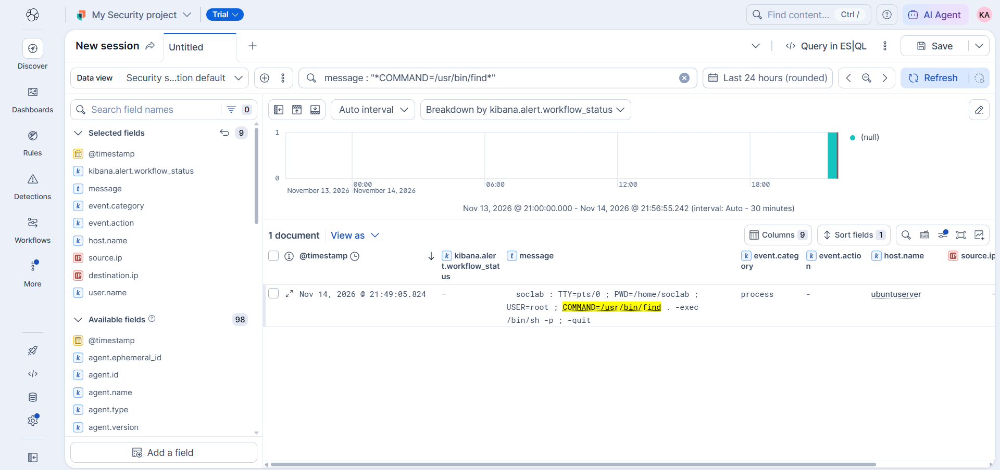
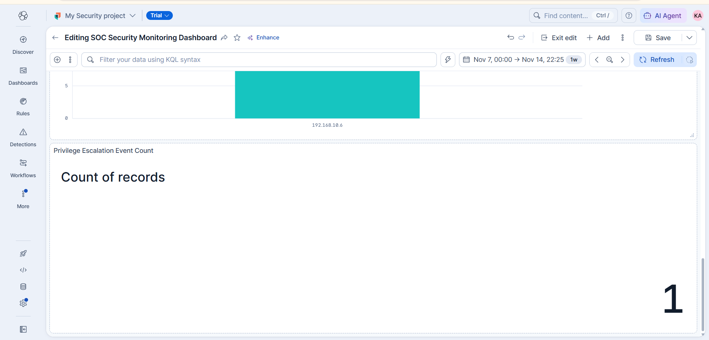
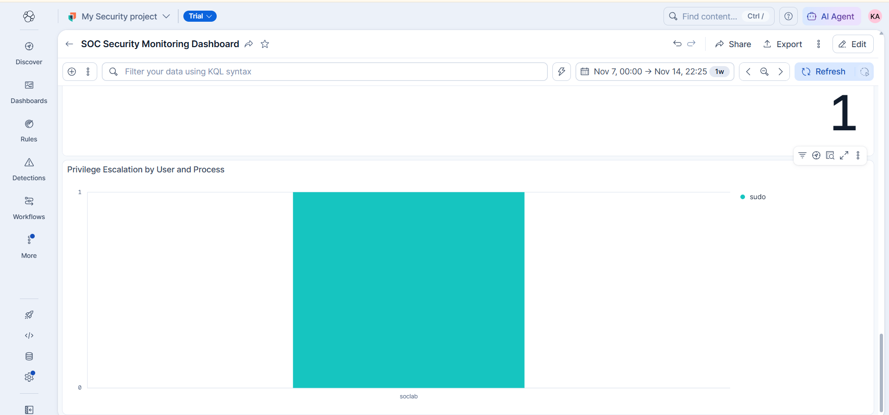
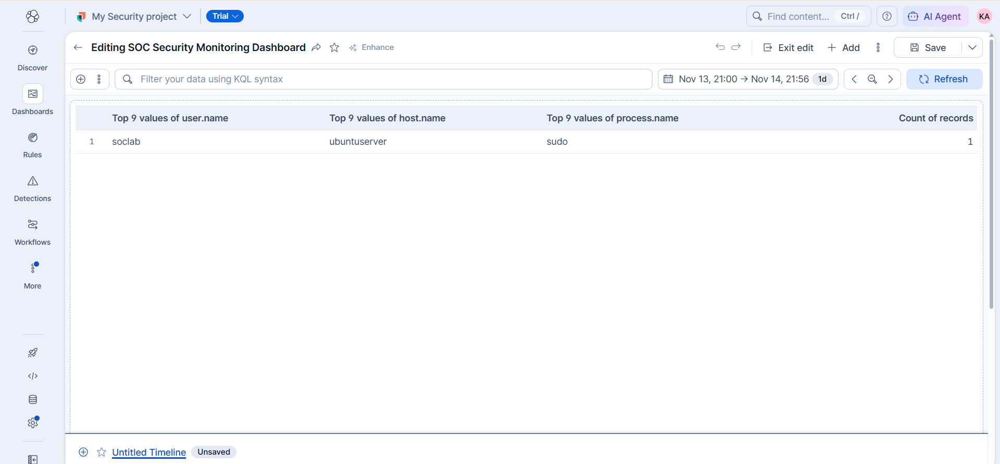

# Scenario 2 – Privilege Escalation Detection and Monitoring

## 1. Introduction

In this scenario, I performed a controlled privilege escalation simulation on an Ubuntu Server by configuring a passwordless sudo permission for the `find` command.

The objective was to demonstrate how an incorrectly configured sudo permission could allow a user to execute a command with root privileges. After performing the simulation, I verified the privilege level, investigated the related command execution event in Elastic, and created Kibana visualizations to monitor the activity.

This scenario demonstrates how privilege-related command execution can be investigated and presented through a SIEM dashboard.

## 2. Objectives

The main objectives of this scenario were:

- Configure a controlled sudoers permission for a test user.
- Demonstrate privilege escalation through the permitted `find` command.
- Verify the resulting privilege level.
- Investigate the related command execution event in Elastic.
- Identify the associated user and process.
- Create Kibana visualizations to monitor privilege escalation activity.

## 3. Lab Environment

**Target Machine:** Ubuntu Server

**Test User:** `soclab`

**SIEM Platform:** Elastic Cloud (ELK Stack)

**Log Investigation:** Kibana Discover

**Dashboard:** Kibana Dashboards

**Privilege Configuration:** `/etc/sudoers.d/soclab-lab`

**Command Used for Simulation:** `/usr/bin/find`

## 4. Sudoers Misconfiguration

For this scenario, I created a custom sudoers configuration file on the Ubuntu Server.

The configuration file was:

`/etc/sudoers.d/soclab-lab`

I configured the following sudoers rule:

`soclab ALL=(root) NOPASSWD: /usr/bin/find`

This rule allowed the `soclab` user to execute the `/usr/bin/find` command with root privileges without entering a password.

After creating the configuration, I checked the file permissions and validated the sudoers configuration.

I used the following commands:

`sudo stat -c '%a %n' /etc/sudoers.d/soclab-lab`

`sudo visudo -c`

The file permission check displayed `440`, and the `visudo -c` command confirmed that the sudoers configuration was parsed successfully.

### Evidence 1 – Sudoers Misconfiguration

## 5. Privilege Escalation Execution and Verification

After configuring the sudoers rule, I tested whether the `soclab` user could execute the permitted `find` command with root privileges.

I used the following command:

`sudo /usr/bin/find . -exec /bin/sh -p \; -quit`

This command opened a shell with the privileges obtained through the configured sudo permission.

To verify the privilege level, I executed:

`whoami`

`id`

The output displayed `root` and `uid=0(root) gid=0(root) groups=0(root)`.

This confirmed that the command successfully provided a root-level shell through the configured sudoers permission.

### Evidence 2 – Successful Privilege Escalation

## 6. Privilege Escalation Event Investigation in Elastic

After verifying the privilege escalation on Ubuntu, I checked Elastic Discover for the corresponding command execution event.

I used the following filter to locate the relevant event:

`message : "*COMMAND=/usr/bin/find*"`

The search returned a matching event containing the `/usr/bin/find` command.

This provided evidence that the command execution activity was available in the collected Elastic data and could be reviewed during the investigation.

### Evidence 3 – Privilege Escalation Logs in Elastic

## 7. Kibana Dashboard Visualizations

After locating the relevant event in Elastic, I created visualizations to monitor the privilege escalation activity.

I created panels to display the event count and the associated user and process information.

### 7.1 Privilege Escalation Event Count

I created a visualization named **Privilege Escalation Event Count**.

The panel displayed one matching event in the captured dashboard view.

This visualization provided a quick summary of the recorded command execution activity.

### Evidence 4 – Privilege Escalation Event Count

### 7.2 Privilege Escalation by User and Process

I also created a visualization named **Privilege Escalation by User and Process**.

This visualization displayed the user and process information associated with the matching event.

The captured result showed:

- User: `soclab`
- Process: `sudo`

This helped identify the account and process associated with the recorded privilege-related activity.

### Evidence 5 – Privilege Escalation by User and Process

### 7.3 Privilege Escalation Dashboard

The privilege escalation visualizations were included in the SOC Security Monitoring Dashboard.

The dashboard brought the event count and associated user and process information together, making it easier to review the recorded activity.

### Evidence 6 – Privilege Escalation Dashboard

## 8. Investigation Findings

The investigation confirmed that the configured sudoers permission allowed the `soclab` user to execute the permitted `find` command with root privileges.

The privilege level was verified using `whoami` and `id`.

The related command execution event was also located in Elastic using the message filter.

The captured dashboard results showed:

- Privilege escalation event count: `1`
- User: `soclab`
- Process: `sudo`
- Command associated with the investigation: `/usr/bin/find`

The dashboard visualizations provided a summarized view of the event and helped review the associated user and process information.

## 9. Security Relevance

Incorrect sudoers configurations can create opportunities for privilege escalation.

From a SOC analyst's perspective, reviewing privilege-related command execution can help identify:

- Unexpected use of elevated privileges.
- Misconfigured sudo permissions.
- Commands executed through sudo.
- User accounts associated with privileged activity.
- Potential privilege escalation behaviour requiring investigation.

In this lab, I intentionally configured the sudoers permission to understand how such activity could be generated, verified, and investigated.

## 10. Conclusion

In this scenario, I performed a controlled privilege escalation simulation on an Ubuntu Server by configuring a passwordless sudo permission for the `find` command.

I verified the sudoers configuration, demonstrated the resulting root-level shell, and investigated the corresponding command execution event in Elastic.

I then created Kibana visualizations to display the privilege escalation event count and the associated user and process information.

This exercise provided practical experience in Linux privilege management, sudoers configuration, command execution investigation, Elastic log analysis, and SIEM dashboard development.

All activities were performed in a controlled lab environment for educational and defensive security learning purposes.
