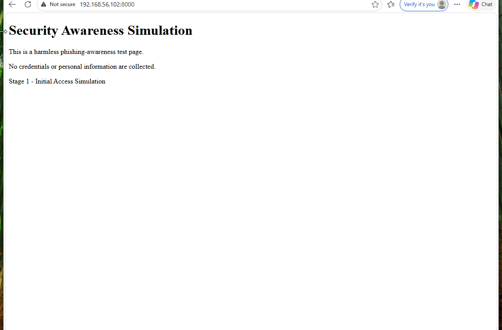
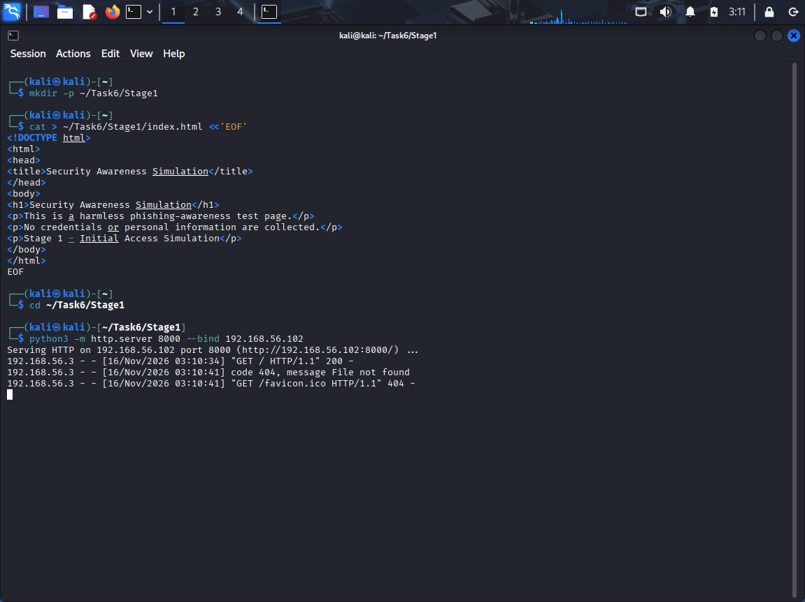
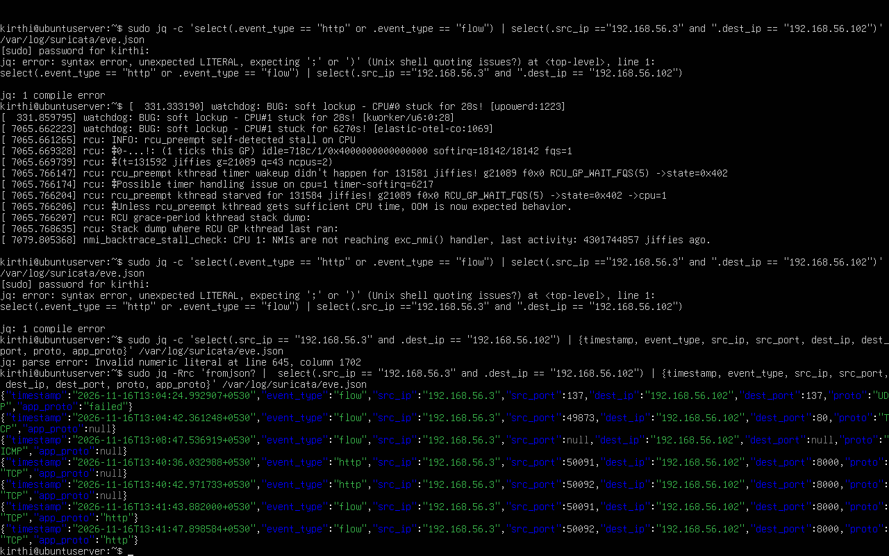
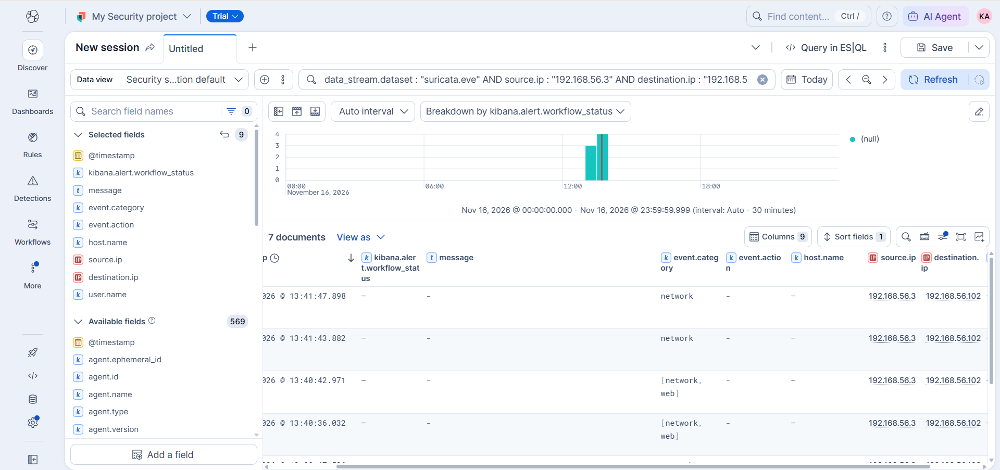

# Stage 1 – Security Awareness Web Simulation and HTTP Monitoring

## 1. Overview

In this stage, I created a harmless security-awareness test page on Kali Linux and accessed it from the Windows 10 victim machine.

The purpose was to simulate a phishing-awareness page access scenario and examine how the resulting HTTP activity could be observed through server access logs, Suricata, and Elastic Security.

The test page clearly stated that it was for awareness testing only and that no credentials or personal information were collected.

This stage focused on generating and validating HTTP activity within the controlled lab environment.

## 2. Lab Environment

**Attacker / Web Server:** Kali Linux

**Victim Endpoint:** Windows 10

**Network Monitoring:** Ubuntu Server with Suricata

**SIEM Investigation:** Elastic Security and Kibana Discover

**HTTP Server:** Python HTTP Server

**HTTP Port:** `8000`

**Kali IP:** `192.168.56.102`

**Windows IP:** `192.168.56.3`

## 3. Security Awareness Page Creation

I created a working directory named `Stage1` on Kali Linux and prepared a simple HTML page named `index.html`.

The page was titled **Security Awareness Simulation**.

It displayed the following information:

- This is a harmless phishing-awareness test page.
- No credentials or personal information are collected.
- Stage 1 – Initial Access Simulation.

The page was intended only to simulate a security-awareness page access scenario. It did not contain a credential collection mechanism.

### Evidence 1 – Windows Security Awareness Simulation Page

## 4. HTTP Server Configuration and Page Access

After creating the HTML page, I started a Python HTTP server on Kali Linux.

The server was bound to the Kali Host-Only IP address `192.168.56.102` and configured to listen on port `8000`.

The Windows endpoint accessed the hosted page through its web browser using the Kali server address.

The Kali terminal recorded the incoming HTTP request from `192.168.56.3`.

The access log showed:

- Request: `GET / HTTP/1.1`
- Response: `200 OK`
- Client IP: `192.168.56.3`

A separate request for `/favicon.ico` returned `404` because a favicon file was not provided. The main page request itself returned HTTP `200 OK`.

### Evidence 2 – Kali HTTP Access Log

## 5. Suricata Network Event Verification

After accessing the page, I examined the Suricata EVE JSON log on Ubuntu Server to identify the corresponding network activity.

I used a `jq` filter to examine records matching the Windows source IP and Kali destination IP.

The investigation focused on the following network details:

- Source IP: `192.168.56.3`
- Destination IP: `192.168.56.102`
- Destination Port: `8000`
- Protocol: `TCP`
- Application Protocol: `HTTP`

The relevant records showed HTTP and flow events associated with communication between the Windows endpoint and the Kali HTTP server.

The JSON filtering command required correction before the relevant records could be displayed successfully.

### Evidence 3 – Ubuntu Suricata HTTP Flow Event

## 6. Elastic Security Investigation

After reviewing the Suricata EVE JSON records, I checked the corresponding events in Elastic Security using Kibana Discover.

I applied filters using the Suricata dataset and the source and destination IP addresses.

The investigation filter targeted:

- Dataset: `suricata.eve`
- Source IP: `192.168.56.3`
- Destination IP: `192.168.56.102`

The search returned seven matching documents in the captured investigation view.

I reviewed the available event information, including timestamps, event categories, source IP, and destination IP.

This confirmed that the relevant Suricata network records were available for investigation in Elastic.

### Evidence 4 – Elastic Suricata Stage 1 Event

## 7. Investigation Findings

The Stage 1 investigation demonstrated the following:

- A harmless security-awareness HTML page was created and hosted on Kali Linux.
- The Windows endpoint successfully accessed the page.
- The Kali HTTP access log recorded the request with an HTTP `200` response.
- Suricata recorded matching network activity between the Windows endpoint and Kali server.
- The related Suricata records were available in Elastic Discover.
- The Elastic investigation returned seven matching documents in the captured view.

The evidence established successful page access and visibility of the associated HTTP network activity.

It did not establish credential theft or successful compromise of the Windows endpoint.

## 8. Conclusion

In this stage, I created a harmless security-awareness test page on Kali Linux and accessed it from the Windows endpoint.

I verified the HTTP request through Kali server logs, examined the corresponding network activity in Suricata, and investigated the collected events in Elastic Security.

This exercise provided practical experience in HTTP server setup, access-log analysis, network event verification, and SIEM-based investigation.

All activities were performed in a controlled virtual lab environment for educational and defensive security learning purposes.
