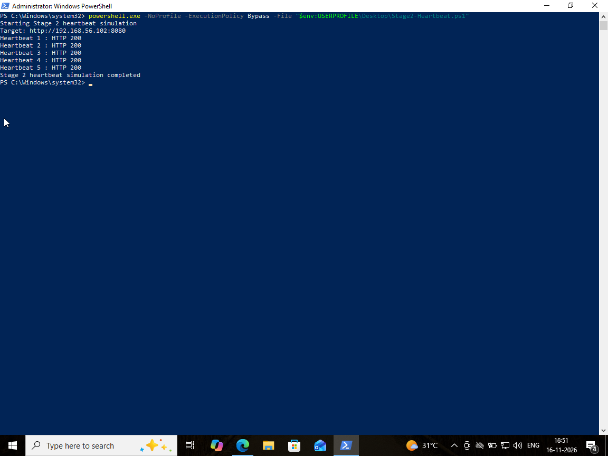
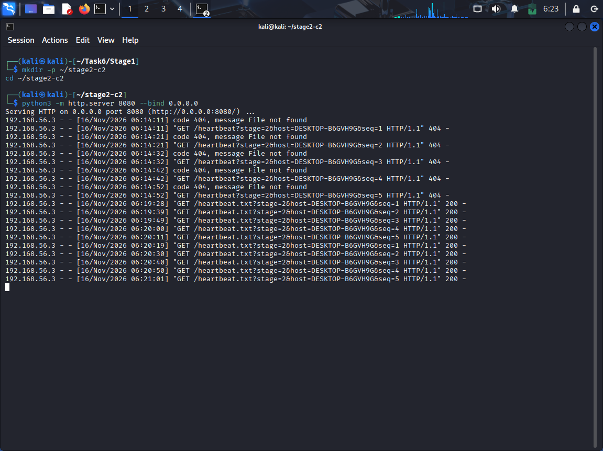
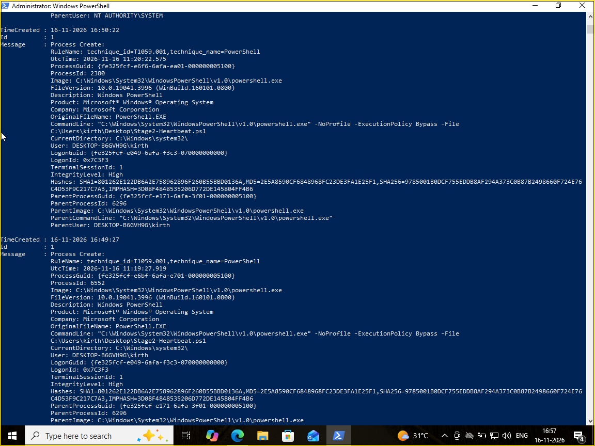
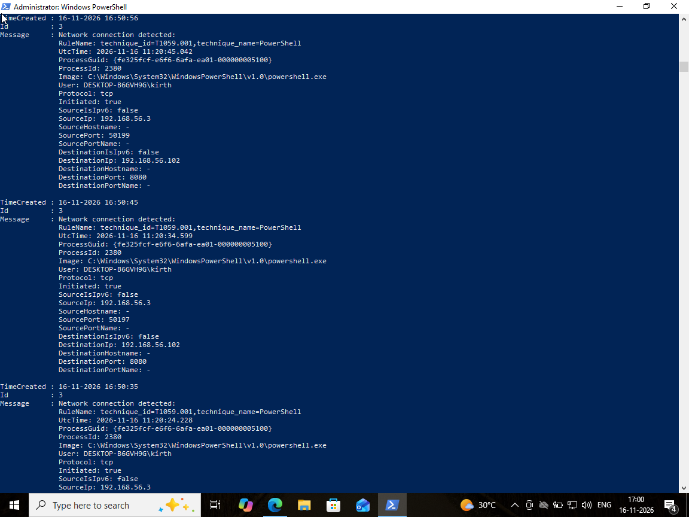
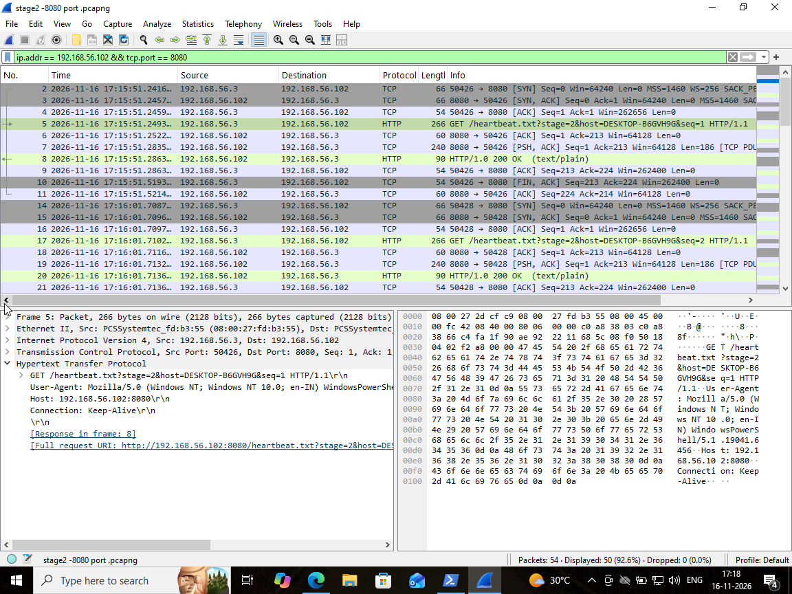
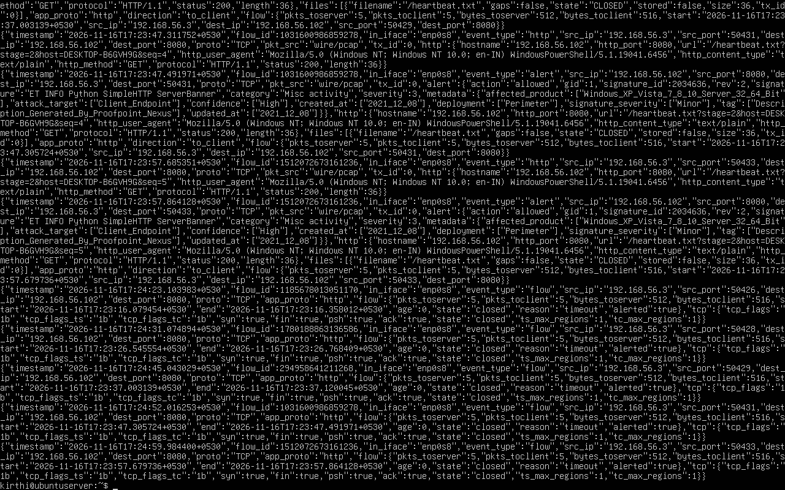
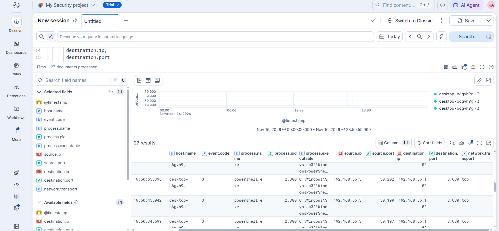

# Stage 2 – PowerShell HTTP Heartbeat Simulation

## 1. Overview

In this stage, I simulated periodic HTTP communication from the Windows 10 endpoint to a Python HTTP server hosted on Kali Linux using a PowerShell script.

The objective was to generate repeated HTTP requests, observe the resulting endpoint and network activity, and investigate the generated events using Sysmon, Wireshark, Suricata, and Elastic Security.

This exercise helped demonstrate how PowerShell-based network communication can be monitored through endpoint and network telemetry.

## 2. Lab Environment

**Attacker / HTTP Server:** Kali Linux

**Victim Endpoint:** Windows 10

**Network Monitoring:** Ubuntu Server with Suricata

**SIEM Investigation:** Elastic Security

**Endpoint Monitoring:** Sysmon

**Packet Analysis:** Wireshark

**HTTP Server Port:** `8080`

**Windows IP:** `192.168.56.3`

**Kali Linux IP:** `192.168.56.102`

## 3. PowerShell Heartbeat Simulation

I created a PowerShell script named `Stage2-Heartbeat.ps1` on the Windows endpoint.

The script was designed to send five periodic HTTP heartbeat requests to the Python HTTP server running on Kali Linux.

The target server address was `http://192.168.56.102:8080`.

I executed the script using Windows PowerShell with the following command:

`powershell.exe -NoProfile -ExecutionPolicy Bypass -File "$env:USERPROFILE\Desktop\Stage2-Heartbeat.ps1"`

The script output displayed five heartbeat requests, each returning HTTP status `200`.

This confirmed that the Windows endpoint successfully communicated with the Kali HTTP server during the validated heartbeat run.

### Evidence 1 – Windows PowerShell Heartbeat Execution

## 4. Kali Linux HTTP Server Logs

On Kali Linux, I started a Python HTTP server on port `8080` using the following command:

`python3 -m http.server 8080 --bind 0.0.0.0`

I monitored the server output to verify incoming requests from the Windows endpoint.

The access logs showed requests to `/heartbeat.txt` with stage, hostname, and sequence information.

The captured logs contained an initial set of HTTP `404` responses, followed by five successful heartbeat requests returning HTTP `200`.

The successful requests identified:

- Client IP: `192.168.56.3`
- Stage: `2`
- Hostname: `DESKTOP-B6GVH9G`
- Sequence values: `1` to `5`
- HTTP response: `200 OK`

This confirmed that the heartbeat requests were successfully received by the Kali HTTP server during the final test run.

### Evidence 2 – Kali Linux HTTP Access Logs

## 5. Windows Endpoint Investigation Using Sysmon

After executing the PowerShell script, I examined the Sysmon Operational event logs on Windows.

I investigated two relevant Sysmon event types.

### 5.1 Sysmon Event ID 1 – Process Creation

Sysmon Event ID 1 was used to examine the creation of the PowerShell process.

The captured event showed:

- Process: `powershell.exe`
- User: `DESKTOP-B6GVH9G\kirth`
- Executable: `C:\Windows\System32\WindowsPowerShell\v1.0\powershell.exe`
- Command line: Execution of `Stage2-Heartbeat.ps1`

This event helped verify that the heartbeat script was executed through PowerShell on the Windows endpoint.

### Evidence 3 – Sysmon Event ID 1

### 5.2 Sysmon Event ID 3 – Network Connection

Sysmon Event ID 3 was examined to identify the network connection initiated by the PowerShell process.

The captured event showed:

- Source IP: `192.168.56.3`
- Destination IP: `192.168.56.102`
- Destination Port: `8080`
- Protocol: `TCP`
- Initiating Process: `powershell.exe`

This provided endpoint-level evidence of the Windows-to-Kali HTTP connection.

### Evidence 4 – Sysmon Event ID 3

## 6. Network Traffic Investigation Using Wireshark

I used Wireshark to inspect the HTTP communication between Windows and Kali Linux.

I applied the following display filter:

`ip.addr == 192.168.56.102 && tcp.port == 8080`

The packet capture showed the TCP connection between the two systems and the HTTP communication associated with the heartbeat request.

The captured HTTP request included:

`GET /heartbeat.txt?stage=2&host=DESKTOP-B6GVH9G&seq=1`

The corresponding server response showed:

`HTTP/1.0 200 OK`

This provided packet-level confirmation of the HTTP heartbeat communication.

### Evidence 5 – Wireshark HTTP Traffic

## 7. Suricata Network Event Investigation

I examined the Suricata EVE JSON records on Ubuntu Server to verify the network activity associated with the heartbeat simulation.

The investigation focused on records matching the Windows source address and Kali destination address.

The relevant network details included:

- Source IP: `192.168.56.3`
- Destination IP: `192.168.56.102`
- Destination Port: `8080`
- Protocol: `TCP`
- Application Protocol: `HTTP`

The observed records contained HTTP and flow-related information associated with the communication.

This provided additional network-level evidence from the Suricata monitoring environment.

### Evidence 6 – Ubuntu Suricata HTTP Logs

## 8. Elastic Security Investigation

After reviewing the endpoint and network evidence, I examined the corresponding network events in Elastic Security.

I used Kibana Discover and the available query capabilities to filter the relevant records using the source and destination IP addresses.

The investigation focused on:

- Event timestamps.
- Event categories and actions.
- Source IP address.
- Destination IP address.
- Network activity associated with the heartbeat requests.

The captured Elastic investigation view displayed seven matching documents for the selected investigation filter.

This confirmed that the relevant network records were available for further review in Elastic.

### Evidence 7 – Elastic Network Investigation

## 9. Investigation Findings

The Stage 2 investigation demonstrated the following:

- The PowerShell heartbeat script executed successfully on Windows.
- Five successful HTTP heartbeat responses were recorded.
- Kali Linux HTTP access logs showed the corresponding requests.
- Sysmon Event ID 1 recorded PowerShell process creation.
- Sysmon Event ID 3 recorded the outbound network connection.
- Wireshark captured the HTTP request and response.
- Suricata recorded the associated network activity.
- Elastic Security provided searchable investigation results.

The combined evidence helped establish the relationship between PowerShell execution and the resulting HTTP communication.

## 10. Conclusion

In this stage, I performed a controlled PowerShell HTTP heartbeat simulation from a Windows 10 endpoint to a Python HTTP server running on Kali Linux.

I verified the successful heartbeat responses through the server access logs and investigated the endpoint activity using Sysmon Event IDs 1 and 3.

I then examined the HTTP packets using Wireshark, reviewed the corresponding Suricata records, and investigated the available network events in Elastic Security.

This exercise provided practical experience in PowerShell process monitoring, network connection analysis, HTTP traffic inspection, and SIEM-based investigation.

All activities were performed within a controlled virtual lab environment for educational and defensive security learning purposes.
