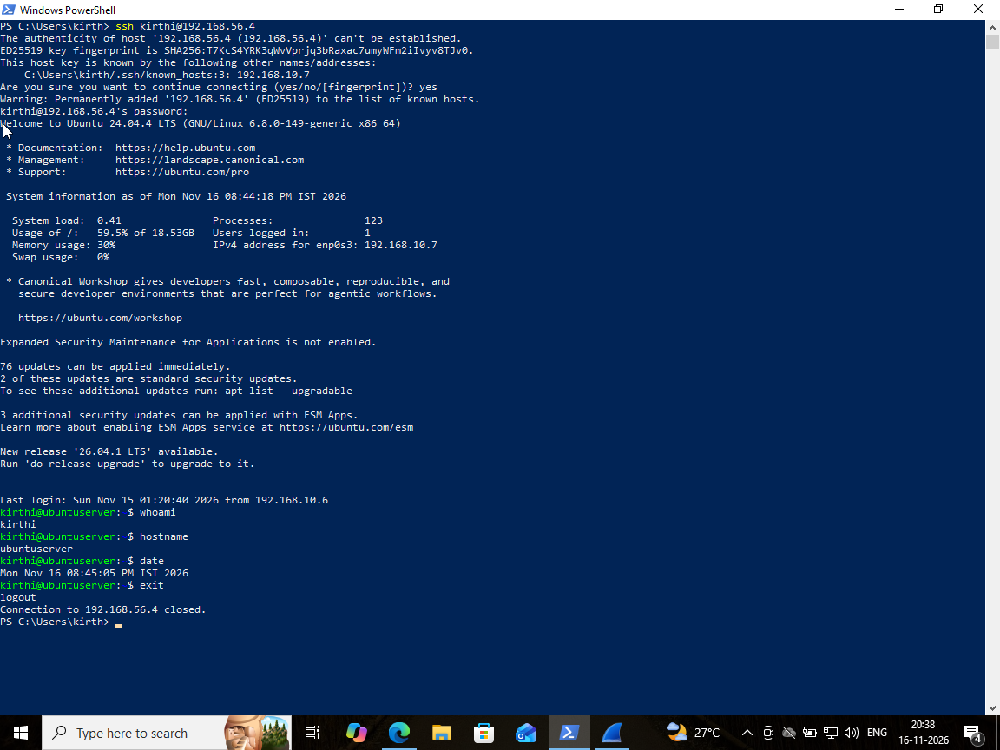
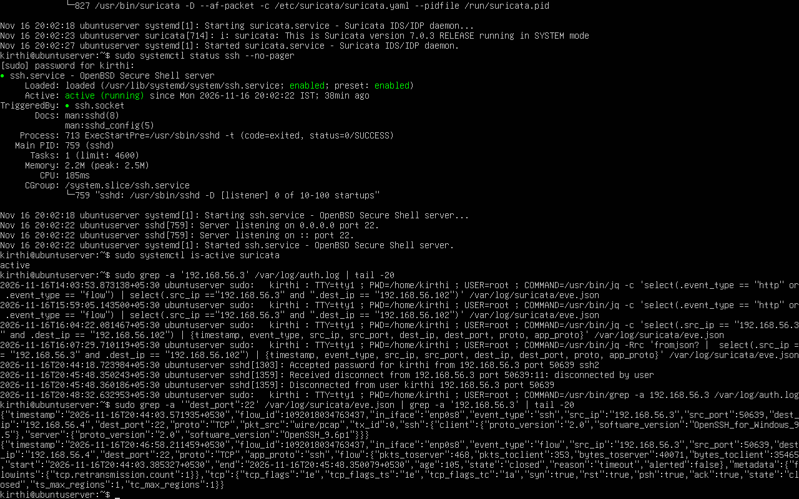
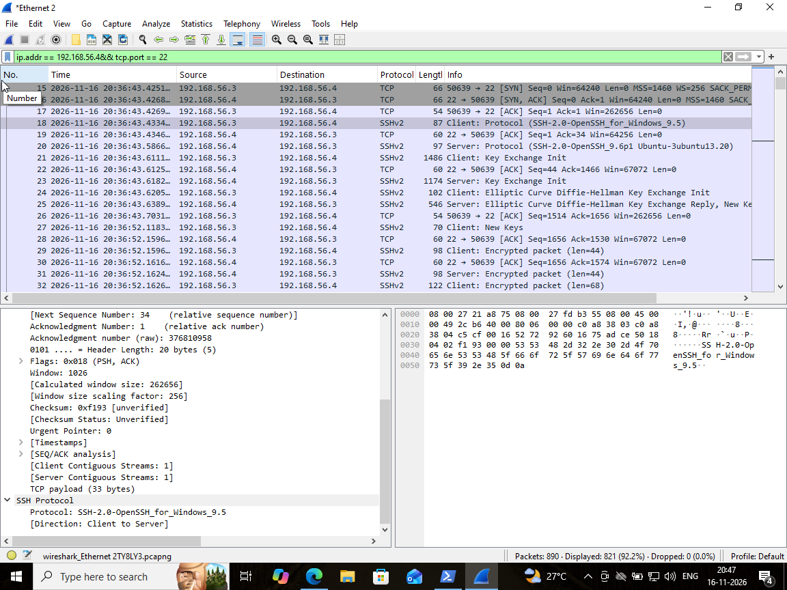
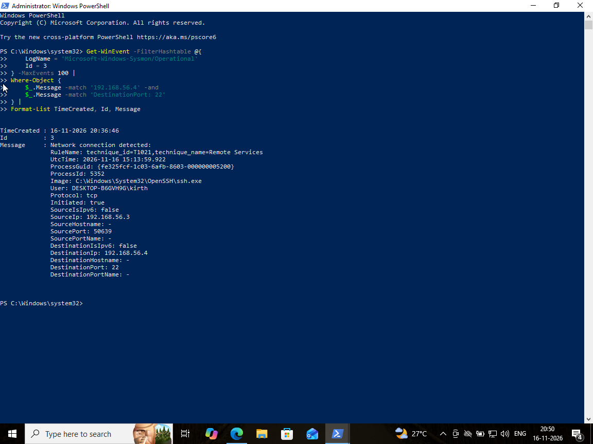
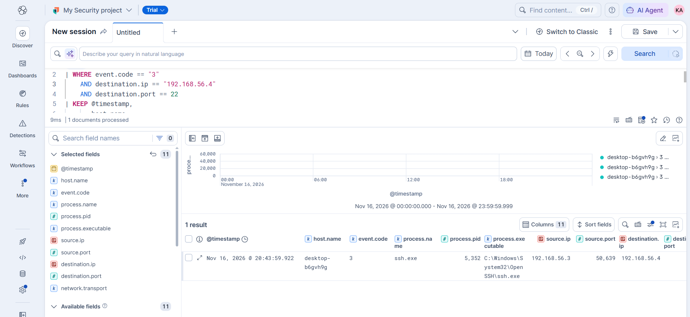

# Stage 5 – SSH-Based Lateral Movement Simulation

## 1. Overview

In this stage, I performed a controlled SSH-based lateral movement simulation from the Windows 10 endpoint to the Ubuntu Server.

The objective was to demonstrate remote access between two lab systems using SSH and investigate the resulting endpoint and network activity.

After establishing the SSH session, I verified the remote system information and examined the corresponding authentication and network records using Ubuntu logs, Sysmon, Wireshark, Suricata, and Elastic Security.

This stage focused on understanding how SSH-based remote access can be monitored and investigated from a SOC perspective.

## 2. Lab Environment

**Source System:** Windows 10

**Destination System:** Ubuntu Server

**Windows Hostname:** `DESKTOP-B6GVH9G`

**Ubuntu Hostname:** `ubuntuserver`

**SSH Account:** `kirthi`

**Windows IP:** `192.168.56.3`

**Ubuntu Host-Only IP:** `192.168.56.4`

**SSH Port:** `22`

**Monitoring Tools:** Sysmon and Suricata

**Investigation Tools:** Wireshark and Elastic Security

## 3. SSH Connection from Windows to Ubuntu

I initiated an SSH connection from the Windows 10 endpoint to the Ubuntu Server using Windows PowerShell.

I used the following command:

`ssh kirthi@192.168.56.4`

After accepting the SSH host-key prompt and providing the account password, the connection was successfully established.

Once connected, I verified the remote session using the following commands:

`whoami`

`hostname`

`date`

The output confirmed that the connected account was `kirthi` and the remote hostname was `ubuntuserver`.

This demonstrated successful SSH-based remote access from the Windows endpoint to the Ubuntu Server.

### Evidence 1 – Windows to Ubuntu SSH Connection

## 4. Ubuntu SSH Service and Authentication Log Verification

After establishing the SSH connection, I verified the SSH service status on Ubuntu Server.

I used:

`sudo systemctl status ssh --no-pager`

The output showed that the SSH service was active and running, with the server listening on TCP port `22`.

I also verified the Suricata service status using:

`sudo systemctl is-active suricata`

The output returned `active`.

To examine the SSH authentication records, I used:

`sudo grep -a '192.168.56.3' /var/log/auth.log | tail -20`

The authentication log contained an entry showing:

`Accepted password for kirthi from 192.168.56.3`

The record confirmed successful SSH password authentication from the Windows endpoint.

The log also showed the corresponding SSH disconnection event.

The Suricata EVE JSON records were examined to review the related network flow.

### Evidence 2 – Ubuntu SSH Service and Authentication Logs

## 5. Network Traffic Analysis Using Wireshark

I used Wireshark to inspect the SSH communication between Windows and Ubuntu Server.

I applied the following display filter:

`ip.addr == 192.168.56.4 && tcp.port == 22`

The packet capture showed communication between:

- Source IP: `192.168.56.3`
- Destination IP: `192.168.56.4`
- Source Port: `50639`
- Destination Port: `22`
- Protocol: TCP
- Application Protocol: SSH

The captured packets included the TCP connection establishment, SSH protocol identification, key-exchange activity, and encrypted SSH packets.

The packet details also showed the SSH client identification associated with Windows OpenSSH and the server identification associated with Ubuntu OpenSSH.

This provided packet-level evidence of the SSH connection between the two lab systems.

### Evidence 3 – Wireshark SSH Traffic Analysis

## 6. Windows Endpoint Investigation Using Sysmon

I examined the Windows Sysmon Operational log to identify the network connection initiated by the SSH client.

The investigation focused on **Sysmon Event ID 3 – Network Connection**.

The captured event contained:

- Rule Name: `T1021`
- Technique Name: `Remote Services`
- Process: `ssh.exe`
- User: `DESKTOP-B6GVH9G\kirth`
- Protocol: `TCP`
- Source IP: `192.168.56.3`
- Source Port: `50639`
- Destination IP: `192.168.56.4`
- Destination Port: `22`

The event showed that the Windows OpenSSH process initiated the network connection to the Ubuntu Server.

This provided endpoint-level evidence of the SSH-based remote access activity.

### Evidence 4 – Sysmon Event ID 3 Supporting Evidence

## 7. Elastic Security Investigation

After reviewing the Windows Sysmon event, I investigated the corresponding network connection record in Elastic Security using ES|QL.

I used the following query:

FROM logs-windows.sysmon_operational-*
| WHERE event.code == "3"
    AND destination.ip == "192.168.56.4"
    AND destination.port == 22
| KEEP @timestamp,
    host.name,
    event.code,
    process.name,
    process.pid,
    process.executable,
    source.ip,
    source.port,
    destination.ip,
    destination.port,
    network.transport
| SORT @timestamp DESC

The query filtered Sysmon network connection events associated with SSH communication to the Ubuntu Server.

The captured Elastic result showed one matching event.

The record included:

- Process: `ssh.exe`
- Source IP: `192.168.56.3`
- Source Port: `50639`
- Destination IP: `192.168.56.4`
- Destination Port: `22`
- Transport Protocol: `TCP`

This helped correlate the Windows endpoint network activity with the SSH communication observed during the simulation.

### Evidence 5 – Elastic SSH Network Investigation

## 8. Investigation Findings

The Stage 5 investigation demonstrated:

- Successful SSH connection from Windows 10 to Ubuntu Server.
- Verification of the remote username and hostname.
- Active SSH service on Ubuntu Server.
- Successful password authentication recorded in Ubuntu authentication logs.
- Suricata network-flow evidence associated with SSH communication.
- Wireshark packet evidence showing SSH protocol activity.
- Sysmon Event ID 3 recording the outbound connection from `ssh.exe`.
- Elastic Security returning one matching network connection event.

The combined evidence established the source, destination, process, and service involved in the controlled SSH-based remote access activity.

## 9. Conclusion

In this stage, I performed a controlled SSH-based lateral movement simulation from the Windows 10 endpoint to the Ubuntu Server.

I verified the remote SSH session, examined the Ubuntu authentication logs, and reviewed the corresponding network traffic using Wireshark and Suricata.

I also investigated the Windows Sysmon Event ID 3 record and used ES|QL in Elastic Security to examine the associated network connection.

This exercise provided practical experience in SSH-based remote access investigation, Linux authentication log analysis, endpoint network monitoring, packet analysis, and SIEM-based investigation.

All activities were performed in a controlled virtual lab environment for educational and defensive security learning purposes.
