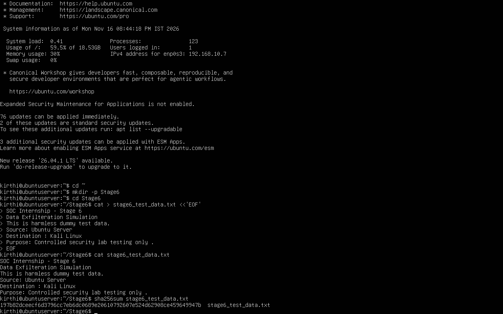
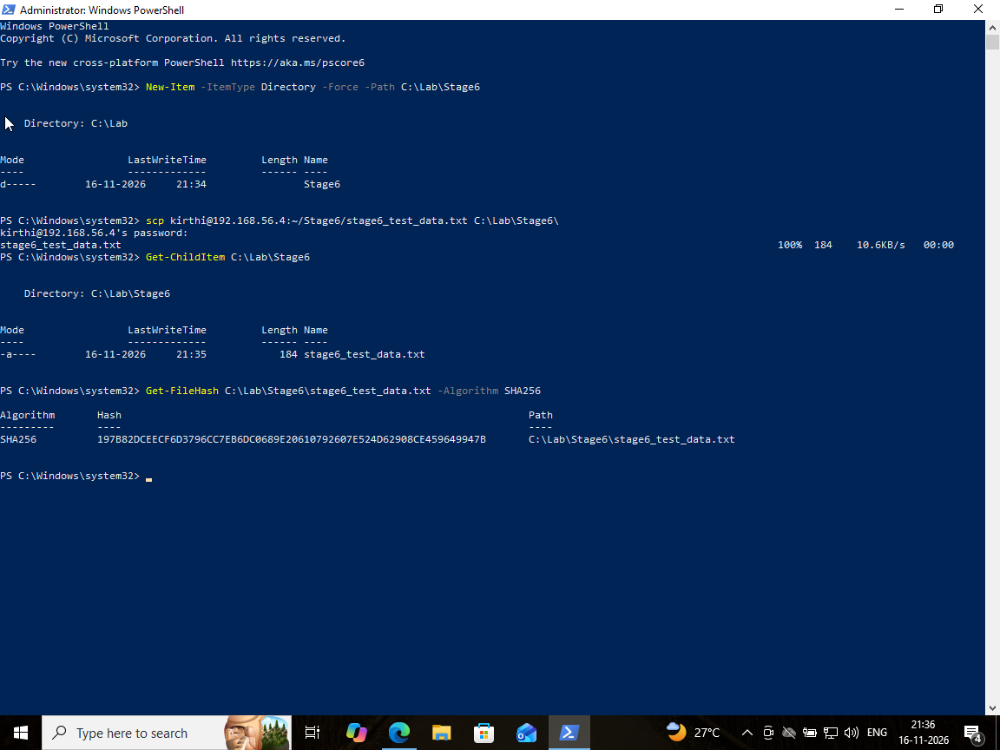
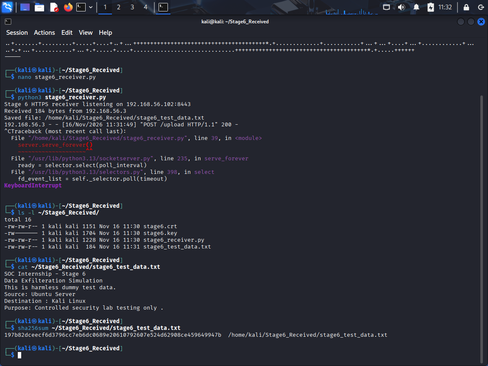

# Stage 6 – Simulated Data Exfiltration Through HTTPS

## 1. Overview

In this stage, I performed a controlled data-transfer simulation using harmless test data across Ubuntu Server, Windows 10, and Kali Linux.

The exercise involved transferring a test file from Ubuntu Server to the Windows endpoint using SCP, followed by an HTTPS upload from Windows to a receiver hosted on Kali Linux.

I verified the file using SHA-256 hashing at different points in the transfer process to confirm that the received file matched the original test file.

The objective was to understand how controlled file transfers can be performed and verified, and how such activity can be documented as part of a security investigation.

## 2. Lab Environment

**Source System:** Ubuntu Server

**Intermediate System:** Windows 10

**Receiving System:** Kali Linux

**Ubuntu IP:** `192.168.56.4`

**Windows IP:** `192.168.56.3`

**Kali IP:** `192.168.56.102`

**Transfer Method 1:** SCP over SSH

**Transfer Method 2:** HTTPS file upload

**HTTPS Receiver Port:** `8443`

**Test File:** `stage6_test_data.txt`

**Verification Algorithm:** SHA-256

## 3. Test File Creation on Ubuntu Server

I created a working directory named `Stage6` on the Ubuntu Server and generated a harmless test file named `stage6_test_data.txt`.

The file contained dummy information specifically created for this controlled lab exercise.

The content identified the activity as a Stage 6 data-transfer simulation and included the source system, destination system, and testing purpose.

I verified the file contents and calculated its SHA-256 hash using:

`sha256sum stage6_test_data.txt`

The original file produced the following SHA-256 hash:

`197b82dceecf6d3796cc7eb6dc0689e20610792607e524d62908ce459649947b`

This hash was recorded as the reference value for subsequent file verification.

### Evidence 1 – Ubuntu Test File Creation and SHA-256 Verification

## 4. SCP Transfer from Ubuntu to Windows

After creating and verifying the test file, I transferred it from Ubuntu Server to the Windows endpoint using SCP.

I used the following command in Windows PowerShell:

`scp kirthi@192.168.56.4:~/Stage6/stage6_test_data.txt C:\Lab\Stage6\`

The file was successfully downloaded into the Windows directory:

`C:\Lab\Stage6`

I verified the downloaded file using PowerShell:

`Get-FileHash C:\Lab\Stage6\stage6_test_data.txt -Algorithm SHA256`

The resulting SHA-256 hash matched the original hash generated on Ubuntu Server.

This confirmed that the file transferred successfully from Ubuntu to Windows without a change in its contents.

### Evidence 2 – Windows SCP Transfer and SHA-256 Verification

## 5. HTTPS Receiver Setup on Kali Linux

After verifying the file on Windows, I prepared an HTTPS receiver on Kali Linux.

The receiver script was named `stage6_receiver.py` and was executed using Python.

The receiver listened on:

`192.168.56.102:8443`

The receiver was configured to accept file uploads through the `/upload` endpoint.

After the Windows endpoint submitted the test file, the Kali terminal displayed the following information:

- Received file size: `184 bytes`
- Source IP: `192.168.56.3`
- Received filename: `stage6_test_data.txt`
- Upload endpoint: `/upload`
- HTTP response: `200 OK`

The receiver saved the uploaded file in:

`/home/kali/Stage6_Received/stage6_test_data.txt`

This confirmed that the HTTPS upload request from the Windows endpoint was successfully received by the Kali receiver.

### Evidence 3 – Kali HTTPS Receiver and File Reception

## 6. Received File Verification on Kali Linux

After receiving the uploaded file, I verified its presence in the Kali receiving directory.

I reviewed the file contents using:

`cat ~/Stage6_Received/stage6_test_data.txt`

I then calculated its SHA-256 hash using:

`sha256sum ~/Stage6_Received/stage6_test_data.txt`

The hash of the received file matched the original SHA-256 hash calculated on Ubuntu Server.

The matching hash confirmed that the test file retained its contents during the transfer process.

## 7. Investigation Findings

The Stage 6 exercise demonstrated the following:

- Creation of harmless dummy test data on Ubuntu Server.
- Original SHA-256 hash calculation.
- Successful SCP transfer from Ubuntu Server to Windows.
- SHA-256 verification on Windows.
- HTTPS receiver setup on Kali Linux.
- Successful file upload from Windows to Kali.
- Receiver confirmation of `184 bytes`.
- HTTP `200` response from the receiver.
- Successful verification of the received file on Kali.
- Matching SHA-256 hashes across the original and received files.

The transfer sequence was:

**Ubuntu Server → Windows 10 → Kali Linux**

The hash comparison provided evidence that the file contents remained consistent across the transfer process.

## 8. Conclusion

In this stage, I performed a controlled file-transfer simulation across Ubuntu Server, Windows 10, and Kali Linux using SCP and HTTPS.

I created harmless test data on Ubuntu, transferred it to Windows using SCP, and verified its SHA-256 hash.

I then uploaded the same file from Windows to an HTTPS receiver hosted on Kali Linux and verified the received file using SHA-256 hashing.

The matching hashes confirmed the integrity of the transferred test data.

This exercise provided practical experience in SSH-based file transfer, HTTPS file upload, receiver-side verification, hash-based integrity checking, and documenting simulated data-transfer activity.

All activities were performed in a controlled virtual lab environment using harmless test data for educational and defensive security learning purposes.
