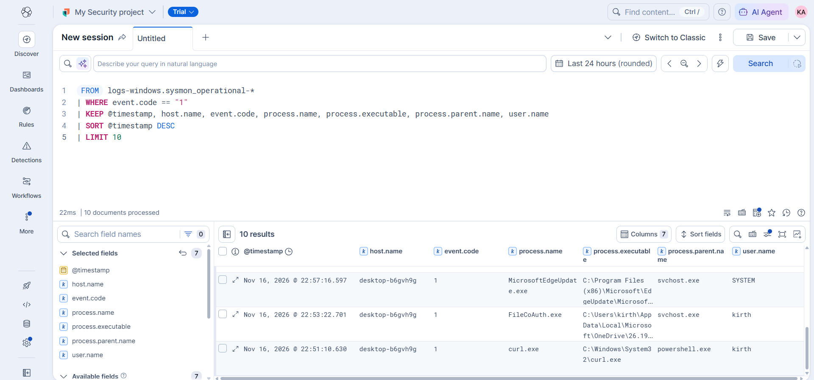
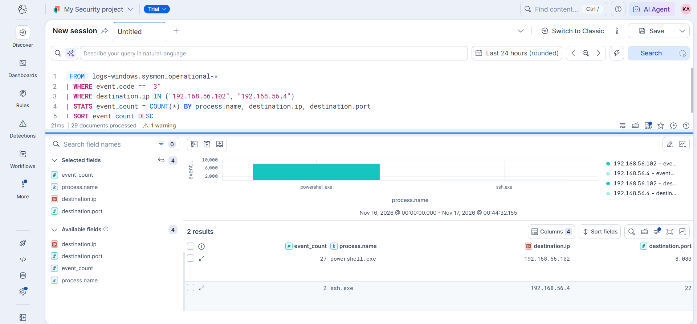

# Stage 7 – Sysmon-Based Detection and Elastic Security Investigation

## 1. Overview

In this stage, I performed endpoint security event analysis and network connection investigation using Microsoft Sysmon and Elastic Security.

After completing the six controlled simulation stages, I examined the Windows endpoint telemetry to understand the process execution and network activities recorded during the lab exercises.

I used ES|QL queries in Elastic Security to summarize Sysmon event activity, investigate individual process creation records, and identify network connections involving the Kali Linux and Ubuntu Server systems.

The investigation focused on understanding the relationship between process execution, parent processes, user context, and outbound network connections.

This stage represents the defensive investigation phase of the project, where the available endpoint telemetry was reviewed to identify and examine activities associated with the earlier simulation stages.

## 2. Investigation Environment

**Endpoint:** Windows 10

**Hostname:** `DESKTOP-B6GVH9G`

**User Account:** `kirth`

**Endpoint Monitoring:** Microsoft Sysmon

**SIEM Platform:** Elastic Security

**Investigation Interface:** Kibana Discover / ES|QL

**Data Source:** `logs-windows.sysmon_operational-*`

**Relevant Sysmon Events:**

- Event ID 1 – Process Creation
- Event ID 3 – Network Connection

**Lab Systems Investigated:**

- Kali Linux: `192.168.56.102`
- Windows 10: `192.168.56.3`
- Ubuntu Server: `192.168.56.4`

## 3. Investigation Approach

The investigation was performed in three steps.

First, I reviewed the distribution of available Sysmon event codes to understand the endpoint activity recorded in Elastic.

Next, I examined process creation events to identify the processes executed on the Windows endpoint, including their executable paths, parent processes, command lines, and associated user accounts.

Finally, I investigated network connection events to identify communication from the Windows endpoint to the Kali Linux and Ubuntu Server systems.

This approach helped examine both process-level and network-level telemetry rather than relying on a single event record.

## 4. Sysmon Event Code Analysis

### Objective

The first investigation focused on understanding the distribution of Sysmon event codes available in Elastic Security.

This provided an overview of the recorded endpoint activity and helped identify event types for further investigation.

### ES|QL Query

    FROM logs-windows.sysmon_operational-*
    | STATS event_count = COUNT(*) BY event.code
    | SORT event_count DESC

### Query Explanation

The query used the following operations:

**FROM**

Reads records from the Windows Sysmon Operational data stream.

**STATS event_count = COUNT(*) BY event.code**

Groups the available records by Sysmon event code and calculates the number of records in each group.

**SORT event_count DESC**

Sorts the grouped results by event count in descending order.

### Investigation Results

The captured Elastic investigation view showed:

- Approximately 12.1K documents processed.
- 17 different event-code groups.
- Event counts summarized by event code.
- A visualization displaying the relative distribution of the event records.

This provided an overview of Sysmon activity available within the selected time range.

The event-code summary was used as the starting point for selecting relevant process and network events for deeper investigation.

### Evidence 1 – Sysmon Event Code Summary

## 5. Process Creation Investigation – Sysmon Event ID 1

### Objective

After reviewing the event-code distribution, I investigated Sysmon Event ID 1 to examine process creation activity on the Windows endpoint.

Process creation records provide useful investigation context, including the executable, process identifier, parent process, command line, and user associated with an execution.

### ES|QL Query

    FROM logs-windows.sysmon_operational-*
    | WHERE event.code == "1"
    | KEEP @timestamp,
        host.name,
        event.code,
        process.name,
        process.executable,
        process.parent.name,
        process.command_line,
        user.name
    | SORT @timestamp DESC
    | LIMIT 10

### Query Explanation

**WHERE event.code == "1"**

Filters the Sysmon records to include only process creation events.

**KEEP**

Selects the fields required for investigation:

- `@timestamp` – Time of process creation.
- `host.name` – Endpoint hostname.
- `event.code` – Sysmon event identifier.
- `process.name` – Name of the created process.
- `process.executable` – Executable path.
- `process.parent.name` – Parent process.
- `process.command_line` – Process command line.
- `user.name` – Associated user account.

**SORT @timestamp DESC**

Displays the most recent process creation records first.

**LIMIT 10**

Restricts the displayed results to the latest ten matching records.

### Investigation Focus – curl.exe Process

Among the returned process creation records, I examined a `curl.exe` execution on the Windows endpoint.

The captured record showed:

- Hostname: `desktop-b6gvh9g`
- Event Code: `1`
- Process Name: `curl.exe`
- Executable: `C:\Windows\System32\curl.exe`
- Parent Process: `powershell.exe`
- User: `kirth`

The record showed that `curl.exe` was launched as a child process of PowerShell.

This parent-child relationship was useful for understanding how command-line network utilities were executed from the Windows endpoint.

The investigation also displayed other process creation records, including `MicrosoftEdgeUpdate.exe` and `FileCoAuth.exe`, demonstrating the additional endpoint activity available in the selected time range.

The presence of `curl.exe` alone does not establish malicious activity. Its execution context and associated network connection must be considered during investigation.

### Evidence 2 – Sysmon Process Creation Investigation

## 6. Network Connection Investigation – Sysmon Event ID 3

### Objective

The next investigation focused on Sysmon Event ID 3 to identify network connections initiated by processes on the Windows endpoint.

The purpose was to examine communication involving the Kali Linux and Ubuntu Server systems and identify the processes and destination ports associated with those connections.

### ES|QL Query

    FROM logs-windows.sysmon_operational-*
    | WHERE event.code == "3"
    | WHERE destination.ip IN ("192.168.56.102", "192.168.56.4")
    | STATS event_count = COUNT(*)
        BY process.name, destination.ip, destination.port
    | SORT event_count DESC

### Query Explanation

**WHERE event.code == "3"**

Filters for Sysmon network connection records.

**WHERE destination.ip IN (...)**

Restricts the investigation to connections involving the two documented lab destinations:

- Kali Linux: `192.168.56.102`
- Ubuntu Server: `192.168.56.4`

**STATS event_count = COUNT(*) BY process.name, destination.ip, destination.port**

Groups the matching network records by:

- Initiating process.
- Destination IP address.
- Destination port.

It also calculates the number of matching records in each group.

**SORT event_count DESC**

Displays the groups in descending order of event count.

### Investigation Results

The captured Elastic query view showed:

- 29 documents processed.
- 2 grouped results.
- 1 warning displayed in the query interface.

The two grouped results were:

### 6.1 PowerShell Network Activity

The first result identified network connection records associated with PowerShell.

- Process: `powershell.exe`
- Destination IP: `192.168.56.102`
- Destination Port: `8080`
- Event Count: `27`

This matched the Kali HTTP server endpoint used during the Stage 2 PowerShell heartbeat simulation.

The result provided endpoint-level visibility into the PowerShell network activity directed towards the Kali HTTP server.

### 6.2 SSH Network Activity

The second result identified network connection records associated with the SSH client.

- Process: `ssh.exe`
- Destination IP: `192.168.56.4`
- Destination Port: `22`
- Event Count: `2`

This matched the Ubuntu SSH destination used during the Stage 5 lateral movement simulation.

The result provided endpoint-level visibility into the SSH connection from the Windows endpoint to Ubuntu Server.

### Evidence 3 – Sysmon Network Connection Summary

## 7. Correlation with Previous Simulation Stages

The Stage 7 investigation helped connect endpoint telemetry with activities performed during the earlier simulation stages.

### Stage 2 – PowerShell HTTP Heartbeat

During Stage 2, the Windows endpoint executed a PowerShell heartbeat script that communicated with the Python HTTP server hosted on Kali Linux.

The Stage 7 network investigation showed 27 Sysmon Event ID 3 records grouped under:

- Process: `powershell.exe`
- Destination: `192.168.56.102`
- Port: `8080`

This provided additional endpoint telemetry associated with the earlier HTTP heartbeat simulation.

### Stage 3 – Scheduled Task Persistence

During Stage 3, a scheduled task named `Stage3-Lab-Persistence` was configured to execute a PowerShell script every two minutes.

The scheduled task activity had already been examined through:

- Windows Task Scheduler Operational events.
- Sysmon Event ID 1.
- PowerShell execution records.
- Elastic process creation investigation.

The Stage 7 process creation investigation continued the endpoint-focused analysis of process execution activity.

### Stage 5 – SSH-Based Lateral Movement

During Stage 5, the Windows endpoint established an SSH connection to Ubuntu Server.

The Stage 7 network investigation showed 2 Sysmon Event ID 3 records grouped under:

- Process: `ssh.exe`
- Destination: `192.168.56.4`
- Port: `22`

This matched the destination and service used during the earlier SSH simulation.

### Stage 6 – Simulated Data Transfer

During Stage 6, a harmless test file was transferred through the lab systems and verified using SHA-256 hashing.

The Stage 7 screenshots do not independently show the Stage 6 HTTPS upload transaction or its file contents.

Therefore, this investigation is not presented as direct detection of the Stage 6 file transfer.

## 8. Overall Investigation Findings

The Stage 7 investigation demonstrated how Sysmon telemetry can be used to examine endpoint process execution and network communication.

The principal findings were:

**Event-Level Analysis**

The event summary query processed approximately 12.1K documents and displayed 17 Sysmon event-code groups in the captured view.

**Process-Level Analysis**

The Event ID 1 investigation displayed ten process creation results. One of the visible records showed `curl.exe` executing under the user `kirth`, with `powershell.exe` as its parent process.

**Network-Level Analysis**

The Event ID 3 investigation processed 29 documents and returned two grouped results:

- `powershell.exe` to Kali Linux on port `8080` – 27 records.
- `ssh.exe` to Ubuntu Server on port `22` – 2 records.

These results connected the observed endpoint network activity with the earlier PowerShell heartbeat and SSH lateral movement exercises.

## 9. Investigation Limitations

This stage focused on retrospective event investigation using Sysmon and ES|QL.

The screenshots demonstrate query results and event analysis. They do not show a separately configured Elastic detection rule, a triggered security alert, or an automated incident response action.

The event counts represent matching Sysmon records in the selected query and time range. They should not be interpreted as an exact number of HTTP requests, SSH sessions, or malicious actions.

Likewise, the presence of a process such as `curl.exe` does not independently establish malicious execution. Process context, command line, destination, and related evidence must be considered together.

These distinctions are important for maintaining accuracy during SOC investigations.

## 10. Conclusion

In this stage, I performed a structured endpoint investigation using Microsoft Sysmon and Elastic Security.

I first summarized the available Sysmon event codes, then examined process creation activity using Event ID 1, and finally investigated network connections using Event ID 3.

The investigation identified PowerShell communication with the Kali HTTP server and SSH communication with the Ubuntu Server.

By correlating these results with the earlier simulation stages, I gained practical experience in connecting endpoint process activity with network communication and investigating the resulting telemetry through ES|QL.

This stage strengthened my understanding of Sysmon event analysis, process investigation, network connection monitoring, endpoint telemetry correlation, and SIEM-based SOC investigation.

All activities were performed within a controlled virtual lab environment for educational and defensive security learning purposes.
